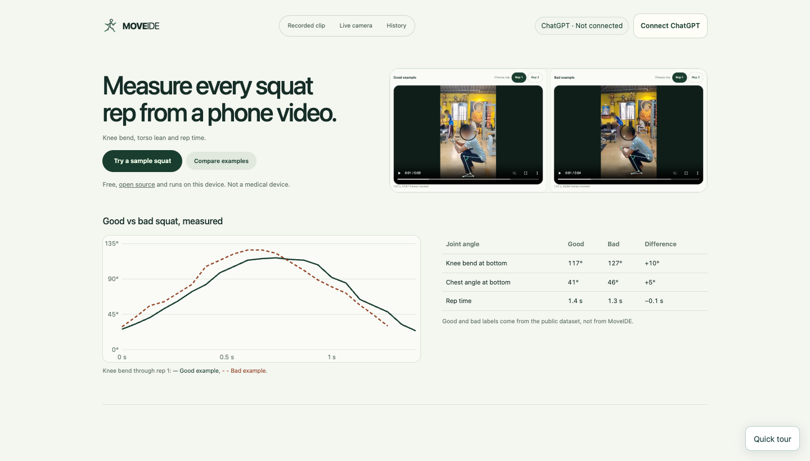

# MoveIDE

Copy this into **Claude or Codex** to set up the existing app:

```text
Set up and run https://github.com/quinn-lgtm26/MoveIDE.git for me.
Use an existing checkout if present; otherwise clone into a new folder.
Read AGENTS.md/CODEX.md or CLAUDE.md, then AI.md, docs/quickstart.md and tracker.md.
Preserve local changes, existing recordings and running services. Check the remote;
update only by a safe fast-forward. Do not recreate the app or replace its models.

Check Node.js 22.18+, npm and Chrome. Run npm run doctor (read-only); missing
dependencies/models are expected before first setup. If this app is already healthy
on 127.0.0.1:4173, reuse it. Otherwise run npm run demo and keep its terminal alive.
The launcher installs locked dependencies, verifies pose assets and builds the UI.
Run doctor again once ready, then open the actual local homepage for me.

Open History and choose Open demo session if that button is available. Replay its
saved video and coaching without signing in; do not regenerate its notes. If the
bundled demo is absent, show Import session for a .moveide.json session export.
Show me Quick tour, Try a sample squat and the header's Connect ChatGPT button.
For new AI coaching, let me sign in with my own eligible account. Let me grant
any camera permission myself.
Verify real local measurements; report AI success only after a real reply arrives.
Explain local History and keeping the original live tab open for queued reviews.
For optional iPhone pairing, follow docs/quickstart.md and npm run demo -- --phone;
only the dedicated phone service may be public, never the account/provider service.
Leave the working app running. Report the URL, revision and any remaining setup step.
```

An open-source squat analysis and coaching app. Start with a recorded clip or a camera: MediaPipe Heavy measures motion locally, and an optional connected ChatGPT coach reviews bounded source images and measurements. Short coaching notes stay visible alongside the video.

**[Judges: download, connect and try the demo →](docs/JUDGES-START-HERE.md)**

[Set up with Claude or Codex](docs/AI-SETUP.md) · [Quickstart](docs/quickstart.md) · [Developer guide](docs/DEVELOPMENT.md) · [Current status and evidence](tracker.md)



Current production homepage, captured in a fresh browser with the coach explicitly mocked as **Not connected**. The image uses bundled public examples; no personal history, camera or AI inference was used. [Capture details](docs/images/homepage.capture.json).

## Run it

Install [Node.js 22.18 or newer](https://nodejs.org/en/download) and Chrome. From a parent folder on macOS/Linux where `MoveIDE` does not already exist, run:

```sh
git clone https://github.com/quinn-lgtm26/MoveIDE.git && cd MoveIDE && npm run demo
```

The launcher installs locked dependencies, downloads and verifies the pinned Heavy/Full models, builds the UI, and starts the local services. First setup needs network access, disk space and time for the downloads. Keep the terminal open; Ctrl+C stops its owned services.

**Prefer downloading a ZIP on a Mac?** On [GitHub](https://github.com/quinn-lgtm26/MoveIDE), choose **Code → Download ZIP**, extract it, then double-click **[Start MoveIDE.command](Start%20MoveIDE.command)** inside the extracted folder. With Node installed, that file runs the same automatic setup and launch. Keep its terminal open. If you prefer a terminal, run `npm run demo` from the extracted folder.

Open **[the app](http://127.0.0.1:4173/)** or **[live coaching](http://127.0.0.1:4173/harness/live/)**. **Quick tour** highlights the real controls. Choose **Try a sample squat** for the bundled recording or **Compare examples** for two independently analyzed videos. Local measurements work without a ChatGPT connection. Use the persistent header's **Connect ChatGPT** button to sign in with your own eligible account, then start a sample or live session for automatic evidence-linked interpretation.

Already cloned? Preserve your work, update from main when safe, then run `npm run demo` again. Need diagnosis rather than another server? Use **`npm run doctor`**: it checks dependencies, model hashes, runtime files and local service state without installing, changing or stopping anything.

## Replay the portable demo

After updating an existing checkout with a safe `git pull --ff-only` and running `npm run demo`, choose **History → Open demo session**. The authorized recording and manifest are published in `ab492c0`; [nine clean-browser checks](qa/published-demo-replay.json) verify the saved replay without new pose inference or AI. A fresh clone uses the same flow after setup.

The designated demo is **Recorded demo · 7 reps**: approximately 60.2 seconds, seven detected reps and six saved AI reviews. The six-review session cap explains the missing seventh AI note; detected motion and reviewed motion are separate counts. Saved video, measurements, notes and evidence replay without a ChatGPT connection. Connect your own eligible account only to request new coaching.

To move another session between computers, open its **Recording details and downloads → Export session**, then choose **History → Import session** on the destination and select the `.moveide.json` file. The portable package carries the original video, saved notes, source JPEG evidence, measurement data and any prepared pose-report cache together. Import creates a fresh local session ID; it does not transfer account credentials, pairing invitations or a ChatGPT connection. Saved notes are retained as recorded, not regenerated. Without a prepared pose cache, local pose preparation can run once; it makes no new AI request.

If **Open demo session** is absent, update safely and rebuild, or import an exported session file. The [tracker](tracker.md) separates this verified saved-demo replay from pending final hosted QA and accuracy acceptance.

## iPhone camera → MacBook

Install [cloudflared](https://developers.cloudflare.com/cloudflare-one/networks/connectors/cloudflare-tunnel/downloads/) and use this instead of the ordinary startup command:

```sh
npm run demo -- --phone
```

On the Mac, open **Live camera**, choose **iPhone via private link**, and Start. Scan the in-app QR with the iPhone, open it in Safari, tap **Start camera**, and allow the camera. Video streams to the Mac through WebRTC; local tracking and coaching captions return to the phone. The phone needs no MediaPipe installation. Keep the phone foregrounded and the whole body visible.

Only the dedicated pairing service4176 gets temporary HTTPS access. The credential-bearing app/provider4173 stays private. QR encoding is local. Do not publish the pairing link. See [the complete phone checklist and recovery steps](docs/quickstart.md#iphone--macbook).

## What is available

- Recorded Heavy/Full analysis, rep segmentation, source-timed measurements, full-body overlays and replay controls.
- One-Start optional AI coaching with cited evidence. Each live rep can include every other analyzed source frame across the rep (up to 32 JPEGs) and 31 timestamped knee/hip/chest-angle samples; missing evidence stays unavailable. Full video stays local, and playback/seek does not request new inference.
- Two actual video examples with independent hashes, rep selection, phase anchors and descriptive metric differences.
- Live camera analysis and QR/WebRTC phone transport with bounded asynchronous coaching.
- Local angle timelines, completed-rep phase/timing summaries and personal reference curves aligned for pace. Visual practice bands are not accuracy estimates or universal good-form zones.
- OpenCap result import labeled as imported/unverified; native inference remains deferred.
- Local session history: save recorded originals and accepted notes, record live video on the receiving computer, then reopen, search, rename, export/import a portable session, download or delete. Replay makes no new AI request. [History behavior and limits](docs/HISTORY.md).

Measurements are projected or explicitly experimental estimates, not independently validated anatomical angles. Physical iPhone/venue acceptance and moving-camera/orbit accuracy remain separate from the browser fixture tests. The examples are not a validated good/bad technique pair. [Read what was actually tested](qa/latest-local-checkpoint.json).

## Save and review

“Save on this device” is on by default. For live sessions, press **Stop** to finalize and save; recordings are limited to five minutes / 100 MiB and may cover only the beginning of a longer session. History belongs to this browser profile at this app address. Use Export session for a portable backup with video, notes and evidence; separate original-video and measurement downloads remain available. ChatGPT sign-in does not sync recordings. If saving fails, use Retry or download the unsaved video and analysis before leaving.

The earlier polished `f4a987a` Wren rerun passed **3/3**. Later queue, replay, graph and reference changes have their own local evidence; newer final Wren acceptance remains pending. See the [current evidence and remaining checklist](tracker.md). Physical iPhone and independent movement accuracy remain separate gates. Live Stop drains queued reviews while the original tab remains open; wait for them to finish before leaving.

## Developers and coding assistants

| Start here | Purpose |
| --- | --- |
| [Claude and Codex copy-paste prompts](docs/AI-SETUP.md) | Set up the existing product, verify it, and leave it running |
| [Development guide](docs/DEVELOPMENT.md) | Commands, architecture, module contracts, tests, parallel work and release checklist |
| [Frontend handoff](harness/FRONTEND-HANDOFF.md) | Shared APIs and integration requirements |
| [UI/UX amendment](docs/frontend-design-amendments.md) | One-Start flow, stable coaching cards, capture/recovery and uncertainty |
| [Global tracker](tracker.md) and [epics](_bmad-output/specs/epics.md) | Owners, implementation status and acceptance evidence |
| [workflow.html](workflow.html) | Download/open the standalone interactive development workflow |
| [AnalysisReport/CoachPacket contract](_bmad-output/specs/shared/analysis-report-v1.md) | Versioned shared data and evidence rules |
| [Fixture provenance](fixtures/squat/README.md) | Attribution, labels and what they do or do not prove |

For a controlled development build, `CI=1 npm run dev` skips the historical automatic Git pull. `npm run typecheck`, `npm test` and `CI=1 npm run build` are the main local gates. Chrome is required for the default browser tests; see the developer guide for scoped verifiers. No Seldon credits are needed to install or use local analysis. Final Wren runs are budgeted separately in [AI.md](AI.md) and [the ledger](qa/seldon-ledger.md).

Source is [MIT](LICENSE); model/runtime, QR and dataset attributions are in [third-party notices](harness/setup/THIRD-PARTY-NOTICES.md) and the fixture documentation.
