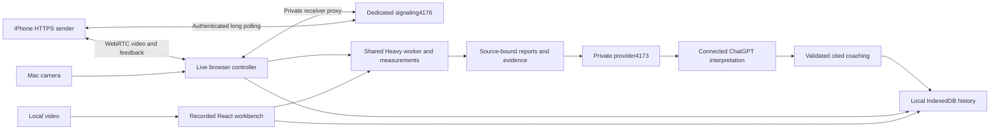

# Developing MoveIDE

MoveIDE has a React recorded workbench, a browser-native live page, shared local motion/coaching modules, a private Node provider, and a dedicated phone-signaling service. Start with [the tracker](../tracker.md); evidence names its tested revision and does not transfer automatically to later builds.

## Environment and commands

Use Node22.18+ and macOS/Linux. Node26.13.0 on macOS is the current tested development environment. Chrome must be installed for the repository's default Playwright browser tests. Camera/ChatGPT permission and physical iPhone tests are separate from automated fixtures. Optional phone mode uses an installed cloudflared executable.

```sh
# Fresh setup; installs locked app+harness dependencies and pinned model/runtime assets.
npm run demo -- --setup-only

# Read-only diagnostics, safe while another MoveIDE demo is running.
npm run doctor
node scripts/doctor.mjs --json

# Complete local product, including optional account setup.
npm run demo

# Alternative startup with trusted HTTPS for the phone sender only.
npm run demo -- --phone

# Hot-reload development; CI=1 skips the historical predev automatic git pull.
CI=1 npm run dev

# Static typing, full automated tests, and production artifact.
npm run typecheck
npm test
CI=1 npm run build
```

Run demo and phone mode as alternatives, not simultaneously. Development defaults to5173; ChatGPT inference is enabled only on the configured private4173 preview. Browser history belongs to its exact origin:5173 and4173 have different local databases. Use4173 consistently for the user demo.

The launcher invokes the compiler/build directly and never pulls Git. `npm run dev`/`npm run build` retain historical pre-hooks that pull when`CI` is unset; use the commands above for controlled development. Never publish a build while an uncontrolled pull could change its source.

## Architecture and boundaries



The phone's HTTPS address exposes only dedicated transport routes, not provider credentials or repository files. QR encoding happens locally. Phone signaling uses long polling; receiver events remain local. Video uses WebRTC; a tunnel working does not prove media connectivity. No TURN service is configured for arbitrary networks. [Transport details](../harness/live/transport/README.md).

| Responsibility | Entry point / contract |
| --- | --- |
| Recorded UI and orchestration | [App.tsx](../src/App.tsx), [analyze adapter](../src/analyze.ts) |
| Two independent recordings | [CompareRecordings.tsx](../src/CompareRecordings.tsx), [shared comparison](../harness/motion/compare-recordings.d.mts) |
| Motion/model/decoded source time | [analyze.d.mts](../harness/motion/analyze.d.mts), [model pins](../harness/motion/pose-model.mjs), [decoder](../harness/motion/video.mjs) |
| Live analysis and bounded scheduling | [live contract](../harness/live/motion/index.d.mts), [live app](../harness/live/app.mjs) |
| Reports, packets and cited interpretation | [shared schema](../_bmad-output/specs/shared/analysis-report-v1.md), [coaching API](../harness/coaching/index.d.mts) |
| Local provider | [provider middleware](../harness/provider/local-server.mjs); account state is private, not in history/Git |
| Local history and recordings | [history requirements](HISTORY.md); shared`harness/history/` and root history UI |
| Launcher and diagnostics | [start-demo.mjs](../scripts/start-demo.mjs), [doctor.mjs](../scripts/doctor.mjs) |
| Product / design / statuses | [epics](../_bmad-output/specs/epics.md), [UX amendment](frontend-design-amendments.md), [workflow](../workflow.html) |

## Development invariants

- Reuse the motion engine; do not duplicate frontend geometry. Preserve source/rep/model identities and null unavailable values.
- Use actual decoded media time when available. Safari's missing-frame-callback fallback is requested seek time, not proof of decoded-frame PTS.
- Playback, history reopen and phase seeking must not trigger inference. Accepted coaching is evidence-bound; Stop invalidates pending replies but retains accepted notes.
- New source/model/session invalidates stale work. View changes reset current metric baselines while preserving immutable completed-rep evidence as historical.
- History writes are local, atomic and versioned; original video hashes and evidence references survive reopen. Never save OAuth/room credentials or silently evict older sessions to fit a new one.
- Keep Heavy/Full pins and both package locks reproducible. Models are downloaded/verified during setup; do not add generated model files to Git.
- Full-body landmarks and estimated world XYZ do not establish independent anatomical-angle or arbitrary-camera accuracy.

## Verification matrix

| Change | Required verification |
| --- | --- |
| Report, metric, source or coaching logic | Relevant harness tests, schema/source regressions, typecheck |
| Recorded UI orchestration | `node harness/verify/root-coaching.mjs` after production build; controlled provider, no account spend |
| Two-source comparison | `node harness/verify/two-recordings.mjs`; isolated development port4189 |
| Live controller / transport | `npm test`; browser tests use synthetic cameras and ephemeral transports |
| History / recording persistence | Shared storage/recorder tests plus reload/reopen/no-new-inference browser journey; see history acceptance |
| Setup or dependency pins | Launcher/doctor tests; fresh checkout setup-only + build; check model/runtime hashes |
| Phone release | Physical iPhone/Mac camera permission, QR, stream, return feedback, Stop/reconnect/foreground test |
| Final prize qualification | Both Wren cases on final exact build, with ledger/debit reconciliation; held until product ready |

Some verifiers write evidence files. Review the diff and record whether the provider was real or mocked, source revision, fixtures, and which devices were actually used. Run GPU-heavy browser verifiers serially to avoid making throughput tests contend with each other. Tests must not attach to or stop a user's active demo.

## Working with parallel contributors

Fetch main before editing and before pushing. Assign file ownership for overlapping UI/contract work; communicate additive API changes through checked-in amendments. Commit coherent changes, then rebase onto the latest main when needed. Resolve conflicts by preserving both intended behaviors and rerun affected checks. Use normal fast-forward pushes; never force-push shared main. Do not stash/reset someone else's uncommitted work.

Update tracker, relevant epics and workflow status with evidence. Keep unfinished device/accuracy gates visible. The repository includes BMAD specs; if your BMAD runner fails, record that failure rather than labeling the workflow complete or bypassing its runner.

## Packaging, licenses and release

App source is [MIT](../LICENSE). MediaPipe runtime/models have their own Apache-2.0 notices, QRCode has MIT attribution, and video fixtures retain dataset attribution ([notices](../harness/setup/THIRD-PARTY-NOTICES.md), [fixtures](../fixtures/squat/README.md)). Native OpenCap inference is user-deferred; the existing import adapter does not package OpenCap/SMPL assets or confer their licenses.

Before a release: clean source state, record commit, run affected checks/build, test a fresh setup, verify local-only/provider/phone boundaries, inspect mobile layout, and link exact evidence. Do not call an older Wren or real-provider run a verification of new code. See [AI.md](../AI.md) for the Seldon budget and [ledger](../qa/seldon-ledger.md).
